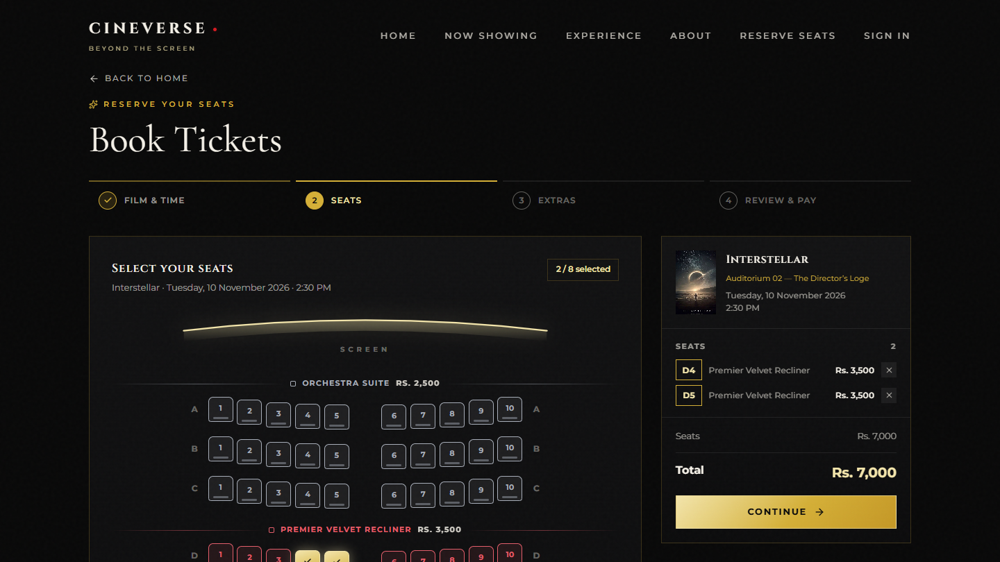
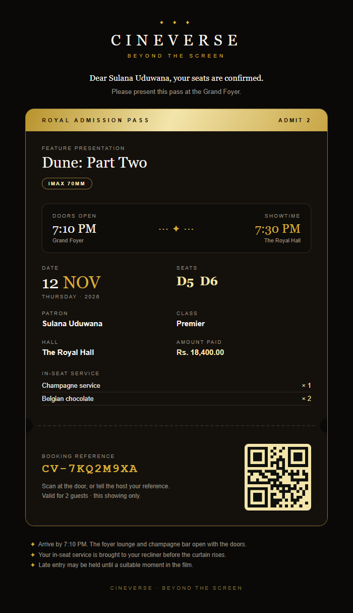

<div align="center">

# ✦ CINEVERSE ✦

**Beyond the Screen** · A luxury cinema website with live seat booking, online payment and an admin dashboard.


</div>

## Features

**For guests**
- Cinematic landing page with a *Now Showing* repertory, filterable by Now Showing, Coming Soon and Special Archive.
- Four-step booking: film and showtime, seats, in-seat extras, then review and pay.
- Live seat map with three price tiers. Seats other people have taken update while you choose.
- All prices in Sri Lankan rupees (LKR).
- A booking is confirmed only after payment succeeds. Seats are held for 10 minutes while you pay.
- E-ticket email styled like a boarding pass, with a QR code for entry.
- Sign-up with a 6-digit email verification code.

**For staff**
- Admin dashboard with revenue and occupancy overview, bookings list with door check-in, film management and auditorium settings.
- Collapsible sidebar (`Ctrl+B`).
- Admin access is stored in the database, not in the code.

## Screenshots

| Now Showing | Seat selection |
| --- | --- |
|  |  |

<p align="center">
  <br />
  <em>E-ticket email</em>
</p>

## Tech stack

| Part | Built with |
| --- | --- |
| Frontend | React 19, Vite 8, React Router 7, lucide-react |
| Backend | Node.js, Express 4, Nodemailer |
| Database and login | Supabase (Postgres, Auth, Row Level Security) |
| Images | Cloudinary |
| Payments | PayHere, or a built-in demo checkout for development |

## Project structure

```
CINEVERSE/
├── frontend/                React app: public site, booking, admin dashboard
│   └── src/
│       ├── features/        auth, booking, landing, admin
│       ├── components/      shared layout (navbar, footer)
│       └── styles/
├── backend/                 Express API
│   ├── src/
│   │   ├── routes/          auth, booking, payments, admin, uploads
│   │   ├── services/        pricing, payments, email, OTP
│   │   ├── templates/       OTP and e-ticket emails
│   │   └── config/          prices, seat layout, booking rules
│   ├── scripts/             create-admin
│   └── supabase/migrations/ SQL to run in Supabase
├── docs/screenshots/
└── package.json             scripts that run both apps
```

## Getting started

### 1. Requirements

- Node.js **22.9 or newer**
- A free [Supabase](https://supabase.com) project
- A Gmail account with an [app password](https://support.google.com/accounts/answer/185833) for sending emails
- A [Cloudinary](https://cloudinary.com) account for poster uploads (optional)

### 2. Install

```bash
git clone https://github.com/Sulana-UX/CINEVERSE.git
cd CINEVERSE
npm run install:all
```

### 3. Add your settings

```bash
cp frontend/.env.example frontend/.env
cp backend/.env.example  backend/.env
```

Fill in both files. See [Environment variables](#environment-variables) below.

### 4. Set up the database

In the Supabase dashboard, open **SQL Editor > New query**, then paste and run each file in order:

1. `backend/supabase/migrations/001_admin_users.sql`
2. `backend/supabase/migrations/002_bookings.sql`
3. `backend/supabase/migrations/003_admin_dashboard.sql`

### 5. Create an admin account

```bash
cd backend
npm run create-admin -- you@example.com "Your Name"
```

The script asks for a password (at least 10 characters) without showing it on screen. Run it again with the same email to reset that password.

### 6. Run

```bash
npm run dev
```

| Page | Address |
| --- | --- |
| Website | http://localhost:5173 |
| Booking | http://localhost:5173/booking |
| Admin dashboard | http://localhost:5173/admin |
| API health check | http://localhost:5000/api/health |

Press `Ctrl+C` to stop both servers.

## Scripts

| Command | What it does |
| --- | --- |
| `npm run dev` | Run the backend and frontend together |
| `npm run dev:frontend` / `npm run dev:backend` | Run one side only |
| `npm run build` | Build the frontend for production (`frontend/dist`) |
| `npm run start:backend` | Start the API without file watching |
| `npm run lint` | Lint the frontend |

## Environment variables

> [!CAUTION]
> Never put secrets in `frontend/.env`. Every `VITE_*` value is bundled into the JavaScript that browsers download. Both `.env` files are git-ignored. Only the `.env.example` files are committed.

**`frontend/.env`**

| Variable | Purpose |
| --- | --- |
| `VITE_SUPABASE_URL` | Supabase project URL |
| `VITE_SUPABASE_ANON_KEY` | Supabase public (anon) key |
| `VITE_CLOUDINARY_CLOUD_NAME` | Cloudinary cloud name |
| `VITE_API_URL` | API address in production only. In development Vite forwards `/api` to port 5000. |

**`backend/.env`**

| Variable | Purpose |
| --- | --- |
| `PORT` | API port (default `5000`) |
| `CORS_ORIGINS` | Frontend addresses allowed to call the API, comma separated |
| `SMTP_HOST`, `SMTP_PORT`, `SMTP_USER`, `SMTP_PASS`, `SMTP_FROM` | Email sending (Gmail app password) |
| `CLOUDINARY_CLOUD_NAME`, `CLOUDINARY_API_KEY`, `CLOUDINARY_API_SECRET` | Signed poster uploads |
| `SUPABASE_URL`, `SUPABASE_SERVICE_ROLE_KEY` | Server-side database access. Keep the service role key on the server only. |
| `PAYMENT_PROVIDER` | `demo` or `payhere` |
| `PAYHERE_MERCHANT_ID`, `PAYHERE_MERCHANT_SECRET`, `PAYHERE_SANDBOX` | PayHere settings |
| `FRONTEND_URL`, `PUBLIC_API_URL` | Return and callback addresses for PayHere |

## How booking works

```
Choose film and time ─▶ Pick seats ─▶ Add extras ─▶ Pay ─▶ Confirmed + e-ticket email
                                                     │
                                         seats held for 10 minutes
```

1. The guest chooses a film, date, time, up to 8 seats, and extras. Seat availability comes live from the database.
2. When they press **Pay**, the server prices everything again from `backend/src/config/booking.js`, creates a `pending` booking and holds the seats for 10 minutes. The database will not let two people hold the same seat.
3. Only the payment provider's server callback can mark a booking `confirmed`. The e-ticket email is sent at that moment.
4. Unpaid holds expire and the seats go back on sale. If a payment arrives after its seats were sold to someone else, the booking is marked `refund_required` for staff to handle.

**Seat prices**

| Tier | Rows | Price |
| --- | --- | --- |
| Orchestra Suite | A to C | Rs. 2,500 |
| Premier Velvet Recliner | D to F | Rs. 3,500 |
| Royal Sovereign Loge | G to H | Rs. 5,000 |

Prices, the seat layout, extras, the 8-seat limit and the 10-minute hold can all be changed in `backend/src/config/booking.js`.

### Payment providers

- **`demo`** (default): a test checkout page at `/booking/checkout/demo`. No money moves. The backend refuses this mode when `NODE_ENV=production`.
- **`payhere`**: real PayHere checkout. PayHere must be able to reach `PUBLIC_API_URL/api/payments/payhere/notify` from the internet. On a laptop, use a tunnel such as `cloudflared tunnel --url http://localhost:5000` and put the tunnel address in `PUBLIC_API_URL`.

## Admin accounts and security

- Passwords are stored hashed by Supabase Auth. They are not in the code.
- The `public.admin_users` table lists which users are admins. Row Level Security lets a signed-in user read only their own row, so nobody can make themselves an admin from the browser.
- The admin check in the browser only decides what the screen shows. Every admin API request is checked again on the server.
- Browsers can read the `movies` table but cannot change it. Films are added, edited and removed through the admin API, which checks the data first: valid showtimes, no two screenings overlapping in the same hall, and no removing a showtime or film that guests have already booked.
- To remove an admin, run `delete from public.admin_users where user_id = '<uuid>';` in the SQL editor.

## API

| Method | Path | Body | Purpose |
| --- | --- | --- | --- |
| GET | `/api/health` | | Status and which services are configured |
| POST | `/api/auth/otp/send` | `{ email, fullName }` | Email a 6-digit code (10 min, 5 attempts, 30 s resend wait) |
| POST | `/api/auth/otp/verify` | `{ email, otp }` | Check a code |
| POST | `/api/auth/register` | `{ email, password, fullName, otp }` | Check the code and create a verified account |
| GET | `/api/booking/config` | | Seat layout, prices, extras and rules |
| GET | `/api/booking/availability` | `?movieId&date&time` | Taken seats for one show |
| POST | `/api/booking/holds` | `{ movieId, date, time, seats, addons }` | Hold seats and start checkout (signed in) |
| GET | `/api/booking/mine` | | The signed-in user's bookings |
| GET | `/api/booking/:ref` | | One booking (owner or admin) |
| POST | `/api/booking/:ref/cancel` | | Release an unpaid hold |
| POST | `/api/payments/payhere/notify` | PayHere form post | Payment result from PayHere |
| GET | `/api/admin/stats` | | Overview numbers and charts (admin) |
| GET | `/api/admin/bookings` | | Paid bookings (admin) |
| POST | `/api/admin/bookings/:id/check-in` | `{ checkedIn }` | Door check-in (admin) |
| GET / POST | `/api/admin/movies` | film fields | List films / add a film (admin) |
| PUT / DELETE | `/api/admin/movies/:id` | film fields | Edit / remove a film (admin) |
| GET | `/api/admin/auditoriums` | | Halls with what is playing now (admin) |
| PATCH | `/api/admin/auditoriums/:id` | `{ status, projectorOn, audioPreset, lightingPreset, temperature }` | Change hall settings (admin) |
| POST | `/api/admin/auditoriums/house-lights` | | Full lights in every hall (admin) |
| GET | `/api/admin/concierge-orders` | | In-seat orders for today and upcoming shows (admin) |
| PATCH | `/api/admin/concierge-orders/:bookingId` | `{ status }` | Pending, Preparing or Delivered (admin) |
| POST | `/api/uploads/cloudinary-signature` | | Signature for a browser upload to Cloudinary |

Verification codes are kept in the API's memory, so they are lost when the server restarts.

## Deploying

- **Frontend:** build with `VITE_API_URL=https://your-api.example.com npm run build` and host `frontend/dist` on any static host, such as Vercel, Netlify or Cloudflare Pages.
- **Backend:** run `npm start` inside `backend/` on a Node host, such as Render or Railway. Set `NODE_ENV=production`, set `CORS_ORIGINS` to the frontend's address, and use `PAYMENT_PROVIDER=payhere`.

---

## Team

| Name | Role |
| --- | --- |
| [Sulana Uduwana](https://github.com/Sulana-UX) | Developer |
| Indeewari Upamalika | Developer |

<div align="center">
Made by Sulana Uduwana and Indeewari Upamalika
</div>
